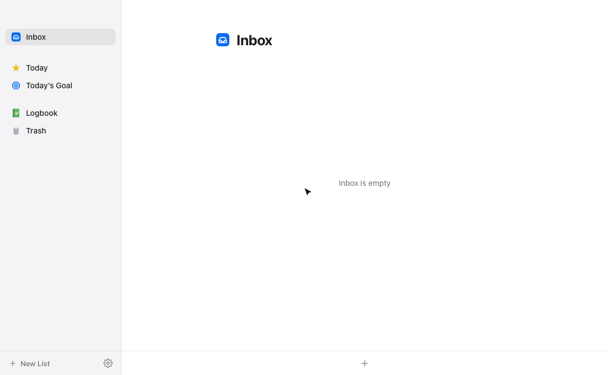

# Sunto

A minimal to-do app for macOS and iPhone, with sync through an iCloud Drive folder.



Press **+** to add a to-do, double-click one to add notes and a date, and tick it off to send it to the Logbook. Use **New List** for projects and areas, the **⋯** menu to switch a project to a Kanban board, and **Today's Goal → Plan** to pick what you'll finish today.

- Inbox, Today, Today's Goal, Logbook and Trash
- Projects, areas, sections, epics and a Kanban board
- Due dates and repeating to-dos
- Offline-first local SQLite storage
- Light and dark mode

## Install

Requires macOS with Xcode, Node 22.12+ and pnpm.

```sh
pnpm install
pnpm mac:install   # build and install to /Applications
pnpm ios:install   # build and install on a connected iPhone
```

On first iPhone install, trust the developer in **Settings → General → VPN & Device Management**. Free Apple accounts need a reinstall every 7 days.

## Sync

Create a **Sunto** folder in iCloud Drive, then choose it when Sunto first opens on each device (or later in **Settings**).

## Use with Claude

`apps/mcp` is an MCP server that lets Claude Code and other agents add, change and complete your to-dos through the sync folder. See [AGENTS.md](AGENTS.md) for setup.

## Develop

```sh
pnpm dev:desktop   # Electron with hot reload
pnpm dev:web       # browser at http://127.0.0.1:5173
pnpm lint && pnpm typecheck && pnpm test:storage
pnpm icons         # re-render app icons from icons/*.svg
```
